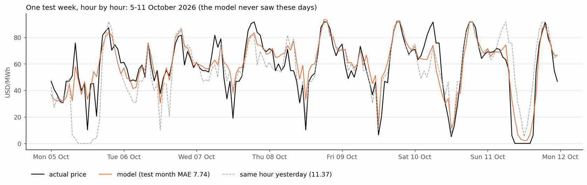
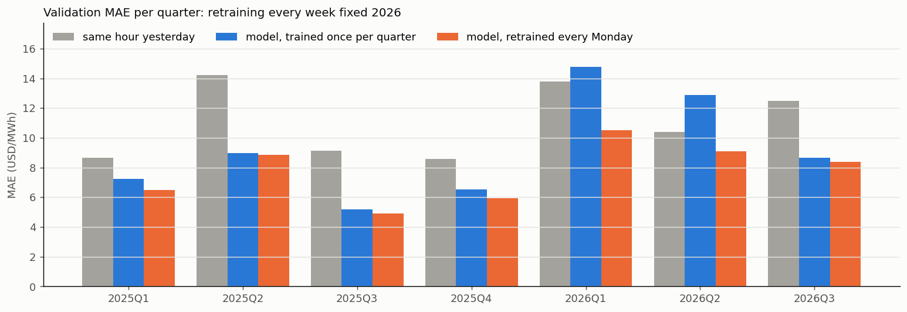
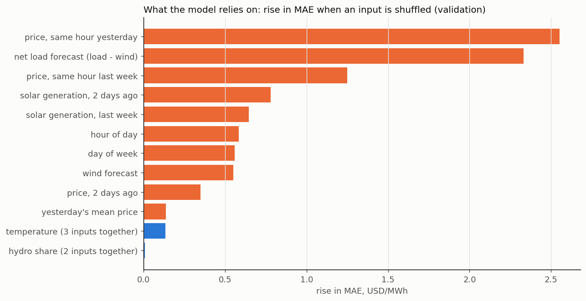
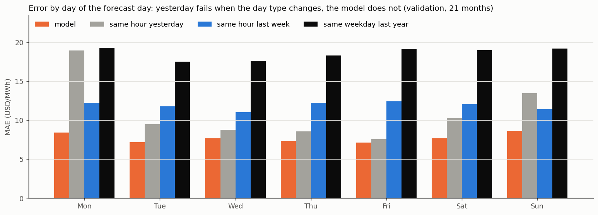
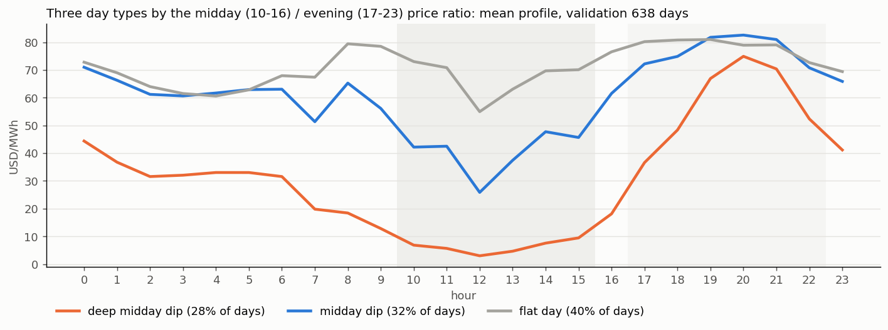
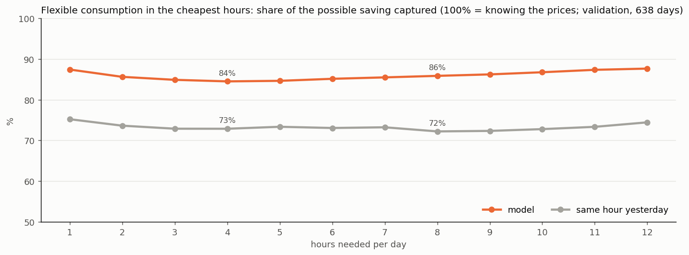
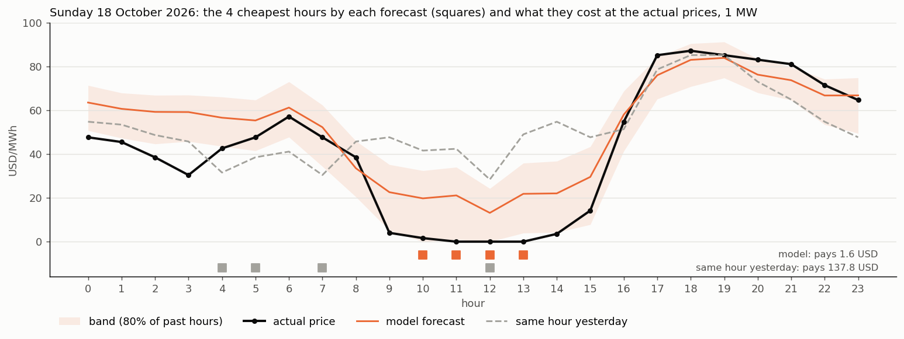

# Turkey Electricity Forecasting

Forecasting next-day **hourly electricity prices (PTF)** in the Turkish day-ahead electricity market, using public data from the [EPİAŞ Transparency Platform](https://seffaflik.epias.com.tr).

Capstone project of the Workintech Data Science bootcamp (November 2026).

## At a glance

- **Forecast:** the 24 hourly prices of tomorrow, made before the 12:30 offer deadline from 21 inputs known at that moment (past prices, EPİAŞ load and wind forecasts, temperature forecasts, past generation, calendar).
- **Model:** tuned HistGradientBoosting, **retrained every Monday**. Chosen by a rule fixed in advance on 21 months of walk-forward validation.
- **Test** (1 October – 1 November 2026, days not used for any choice, scored once):
  - MAE **7.74 USD/MWh**, against 11.37 for the same hour yesterday: **32% less error**.
  - Better on 24 of 32 days. The chance of that record if both forecasts were equally good is about 0.35% (sign test).
- **Against published work:** relative MAE 0.52 on the test (0.65 on validation), in the band of the literature's benchmark models (0.38–0.57) and close to comparable Turkish work (0.63).
- **PTF analysis:** tomorrow's daily mean is missed by 4.40 USD/MWh (yesterday's prices: 7.42), the type of day is right on 78% of days, and an error band built from past errors held 77.5% of test hours (aim 80%).
- **What it is worth:** a site with 4 flexible hours a day, placed in the cheapest hours by the forecast, captures 84% of the possible saving (yesterday's prices: 73%; 638 validation days), about 3,900 USD per MW a year more than following yesterday.
- **Demo:** a Streamlit app that reads tomorrow's price as a bulletin (`app/`), on the test days, in English or Turkish.



The project went through two rounds:

- **Round 1:** the first model, trained once, failed its test in a long low-price period.
- **Round 2:** after a project review, temperature and hydro inputs were added and the model was retrained every week. The model was chosen again on a new split and tested once more.

Both rounds are reported in full below, failures included.

## Problem

An electricity supplier buys most of tomorrow's electricity in the day-ahead market, where the price of each hour of the next day is set separately. Knowing **at what price** each hour is likely to clear — and which hours will be cheap or expensive — drives its buying cost and risk. This project forecasts those 24 hourly prices. Expected demand enters as an input through EPİAŞ's own next-day load forecast.

Offers for the next day are due by 12:30, and the next day's 24 hourly prices are announced at 14:00. A useful forecast must therefore be made before 12:30, using only the information available at that moment.

## Data

Hourly data from January 2023 onwards, downloaded with the EPİAŞ web service (via the [`eptr2`](https://pypi.org/project/eptr2/) package). Raw data is not stored in this repository; it can be downloaded with the fetch script below.

| Table | Content |
|---|---|
| `mcp` | Market clearing price (PTF), day-ahead market |
| `smp` | System marginal price (SMF), balancing power market |
| `wap` | Intraday market weighted average price |
| `dam-clearing` | Day-ahead market matched quantity |
| `rt-cons` | Real-time consumption |
| `load-plan` | Load forecast plan for the next day |
| `rt-gen` | Real-time generation by source |
| `wind-forecast` | Wind generation forecast with quantile bands |

Round 2 adds hourly temperature forecasts for five cities from the [Open-Meteo](https://open-meteo.com) Historical Forecast API (no account needed).

## Forecasting setup

**Target.** The 24 hourly prices of day D+1 in USD/MWh, forecast on day D before the 12:30 offer deadline.

**Inputs (16), only what is known at forecast time.** Every input is checked against an availability rule in code (`src/features.py`), so a feature that would leak future information raises an error:

| Group | Inputs | Why it is known in time |
|---|---|---|
| Past prices | same hour yesterday, 2 days ago and last week; yesterday's daily mean | Day D's prices were published on D-1 at 14:00 |
| Next-day forecasts | EPİAŞ load forecast, wind forecast, net load (load − wind), price cap | Published for D+1 before the deadline |
| Past solar generation | same hour 2 days ago and last week | Realised generation is known up to D-1 |
| Calendar | hour, day of week, weekend, month, official holidays, holiday-eve afternoon | Known in advance |

**Evaluation.** All models are scored on the same periods, with the same metric:

- **Validation (model choice and tuning):** quarterly walk-forward over 2025. Training always starts in January 2024 and ends the day before each validated quarter.
- **Test:** January–September 2026, scored **once**, after the model was fixed.
- **Demo:** October 2026 onwards, never used for training or model choice.
- **Metric:** mean absolute error (MAE, USD/MWh), the average size of an hourly price error. RMSE and MAE on price-floor hours (price = 0) and price-cap hours are reported alongside.
- **Baseline to beat:** *same hour yesterday*, a forecast anyone has for free.

## Results

### Model choice (validation, 2025)

Mean MAE over the four 2025 quarters (USD/MWh, lower is better):

| Model | Default settings | Tuned (Optuna) |
|---|---|---|
| Dummy (training median) | 13.98 | – |
| Same hour last week | 10.28 | – |
| **Same hour yesterday (baseline)** | **10.14** | – |
| Ridge regression | 8.97 | – |
| Random forest | 7.27 | 7.12 |
| HistGradientBoosting | 7.15 | 6.96 |
| **XGBoost** | 7.19 | **6.88** |
| GRU (last 168 hours → next 24 hours) | 10.47 | – |
| GRU, learning the deviation from the baseline | 8.92 | – |

- **Chosen model: tuned XGBoost**, 32% below the baseline's error.
- The three tree-based models were close. XGBoost had the lowest mean error and was the fastest of the three to train.
- The GRU did not get close. One sample is one forecast day, so the network had only 366–639 training days. Learning the deviation from the baseline instead of the price itself helped, but did not close the gap.

The model relies mostly on past prices (about 59% of the total gain) and on the next-day load and wind forecasts (about 20%):


### Test (January–September 2026, scored once)

| Forecast | MAE | RMSE | vs. baseline |
|---|---|---|---|
| **XGBoost, trained once on 2024–2025** | **18.57** | 24.62 | **52% worse** |
| Same hour yesterday | 12.22 | 18.55 | – |
| Same hour last week | 14.08 | 21.10 | 15% worse |

**The model failed on the test period.** It beat the baseline in five of nine months: January, February and July–September. From March to June it was far worse. From February to June it forecast too high every month, by 14–33 USD/MWh on average.

The cause is a market situation the model had never seen:

- In spring 2026 prices stayed low for weeks, with **395 price-floor hours** (price = 0) in nine months. The whole training period (2024–2025) had **46**.
- In 2024–2025 low prices did not last, and the model had learned that a low price is followed by a higher one.


The failure is specific to low prices. In the 60–80 USD/MWh range, the most common price level in the test period, the model's error was about half the baseline's (5.3 vs 11.0). Below 20 USD/MWh it was far worse (37.3 vs 9.8):


### Post-hoc experiment: retraining frequency

> ⚠️ This experiment was decided **after** the test result was known, so it is not the project's test result. Every retraining frequency that was tried is reported here.

Same features, same tuned settings, no new tuning. The model is retrained regularly on all data up to the day before each period it forecasts, as a model in daily use would be:

| Forecast | MAE | vs. baseline | Months better than baseline |
|---|---|---|---|
| Trained once (reported test result) | 18.57 | 52% worse | 5 of 9 |
| Retrained every month | 10.89 | 11% better | 7 of 9 |
| Retrained every week | 9.64 | 21% better | 9 of 9 |
| Same hour yesterday | 12.22 | – | – |

Under weekly retraining, April and May were only marginally better than the baseline (11.55 vs 12.04, 7.50 vs 7.54).

**Practical conclusion:** the model is the same in all three rows; only the update frequency changes. A price model like this must be retrained at least weekly. A single training run is not enough when the market changes.

### Post-hoc experiment: classical time series models and GRU tuning

> ⚠️ Also added **after** the test result was known, to compare more of the methods covered in the bootcamp. The model choice above is unchanged. Every variant that was tried is reported here.

Classical models forecast the price series from its own past. SARIMAX and Prophet also use the next-day net load forecast. All of them forecast D+1 from data known on day D, like the models above:

- **Holt-Winters** (exponential smoothing, additive daily or weekly season). Parameters are estimated at each training. Each day the forecast is updated with the latest prices.
- **SARIMAX** with a daily (24-hour) season. Estimated on the last 8 weeks before the forecast period, because memory grows with the length of the series. Each day its state is updated with the latest prices.
- **Prophet** (daily and weekly season, Turkish holidays). Refitted every day, because it has no cheap way to add new data.

Validation (mean MAE over the four 2025 quarters):

| Model | MAE |
|---|---|
| SARIMAX (1,0,1)(1,0,1,24) | 9.12 |
| SARIMAX (1,0,1)(0,1,1,24) | 9.60 |
| Prophet, with yearly season | 10.00 |
| Same hour yesterday (baseline) | 10.14 |
| Prophet | 10.30 |
| Holt-Winters, daily season | 12.74 |
| Holt-Winters, weekly season | 14.47 |
| *Tuned XGBoost, for comparison* | *6.88* |

On the test period, the best variant of each family was scored under the two protocols above:

| Forecast | Trained once | Retrained every week |
|---|---|---|
| XGBoost | 18.57 | **9.64** |
| SARIMAX (1,0,1)(1,0,1,24) | 15.08 | 10.80 |
| Prophet, with yearly season | 13.48 (refitted daily) | – |
| Holt-Winters, daily season | 16.04 | 16.03 |
| Same hour yesterday | 12.22 | 12.22 |

- **The ranking is the same as in validation:** XGBoost, then SARIMAX, then the baseline.
- **Trained once,** every classical model was better than the frozen XGBoost, because each one updates its forecast with the latest prices every day. None of them beat the baseline.
- **Retrained weekly,** SARIMAX was 12% better than the baseline. It beat weekly XGBoost in February and August.

**Information or model?** XGBoost sees 16 inputs, the classical models one or none. To separate the two reasons, both kinds of model were given the same information (2025 validation, mean MAE):

| | Own past prices only | All inputs |
|---|---|---|
| Time series (SARIMA / SARIMAX) | 9.89 | 10.00 |
| XGBoost | **8.34** | **6.88** |

- **With the same information, XGBoost is still clearly better:** given only past prices and the hour, it reaches 8.34, better than every time series model, and better than ridge with all inputs (8.97).
- **The extra inputs did not help the time series model.** SARIMAX with all inputs (load and wind forecasts, price cap, past solar, holidays, day of week) reached 10.00, worse than with the net load forecast alone (9.12). With the default 50 iterations its estimation did not converge (9.62); with 200 iterations it converged and the result got worse, so the problem is not the estimation. A linear model with a fixed pattern cannot use these inputs the way the price reacts to them (thresholds, the floor and the cap, a different effect of net load at noon and in the evening).
- Thresholds set before the run: time series counted as competitive below 7.38, and "the gap is mostly information" if XGBoost with past prices only were above 8.6. Neither was reached. XGBoost kept its tuned settings with fewer inputs, which slightly favours the full model. The lasso-type autoregressive model of the price forecasting literature (LEAR) was tried in round 2 (below).

**GRU tuning (Optuna).** The rule was set before the search: if the tuned GRU reached a mean validation MAE below 7.5, it would be added to the test table. The search covered history length (3, 7 or 14 days), layers, units, dropout, learning rate and batch size. It was planned for 25 trials and stopped after 15, because the best result had stopped improving and trials took up to an hour. The best settings, trained with three random seeds, reached **8.61** (untuned: 8.92). That is above the threshold, so the GRU was not scored on the test period.

### Business value: shifting flexible load

> Designed after the test result was known. No model was retrained; the saved test forecasts were reused.

A consumer has a flexible job that needs 4 (or 8) hours of 1 MW every day, in any hours. On day D it runs the job in the hours of D+1 that the forecast says are cheapest, and pays the **actual** prices. Two references: no shifting (the day's average price), and perfect foresight (the truly cheapest hours). *Captured share* is the part of the possible saving that the forecast achieved.

Test period, 4 flexible hours per day (average price paid, USD/MWh):

| Forecast | Price paid | Saving vs. no shifting | Captured share | Days worse than no shifting |
|---|---|---|---|---|
| No shifting | 43.09 | – | 0% | – |
| **XGBoost, trained once (reported)** | **24.25** | **18.83** | **85%** | 3 of 273 |
| Same hour last week | 26.01 | 17.08 | 77% | 8 |
| Same hour yesterday | 27.14 | 15.94 | 72% | 13 |
| *XGBoost, retrained weekly (post-hoc)* | *24.32* | *18.77* | *85%* | *2* |
| *SARIMAX, retrained weekly (post-hoc)* | *25.83* | *17.26* | *78%* | *13* |
| Perfect foresight | 20.98 | 22.11 | 100% | – |

With 8 flexible hours the picture is the same (XGBoost trained once 85%, retrained weekly 86%, same hour yesterday 72%).

**The model that failed on MAE was the best at this decision.** For choosing hours only the order of the prices within a day matters, not their level. The frozen model forecast too high in spring, but it still ranked the hours well. It captured more of the possible saving than the baseline in every month except June (92.5% vs 94.3%). The gap was largest in January–March (23–28 percentage points). In April–May every forecast captured 88–97%, because with many hours at the price floor (95 and 214 hours) the cheap hours were easy to find.

### Demo period (October 2026)

The demo uses days that no training run or model choice had seen. Following the retraining result, the tuned XGBoost is retrained every Monday on all data up to the day before:

| Forecast, 1–29 October 2026 | MAE | Days better than the baseline | 4-hour job: captured share of the possible saving |
|---|---|---|---|
| XGBoost, retrained weekly | 7.84 | 19 of 29 | 85% |
| Same hour yesterday | 11.56 | – | 82% |

In October the model was clearly better at the price level (MAE), but only slightly better at picking the cheapest hours: yesterday's daily pattern was already a good guide to today's.

**The demo app now uses the round-2 model** (below): tuned HistGradientBoosting, retrained every Monday, 1 October – 1 November 2026. Its forecasts are identical to the round-2 test. The app reads tomorrow's price for an energy analyst, before the 12:30 deadline (see *PTF analysis, round 2*):

- **Tomorrow's price:** a one-sentence bulletin; daily and tariff-period means; the cheapest n and priciest 4 hours; the day type; the forecast with its error band; the known-ahead inputs next to today's. On request it reveals the actual prices and what the n hours cost by following the model, yesterday's prices, perfect foresight or not shifting.
- **What the cheap hours are worth:** the flexible job over October and over the 638 validation days, for the job length set in the sidebar.
- **Can I trust it?:** MAE, band coverage, cheapest-hour hit rate, day-type agreement and the error by hour of day, against the same-hour-yesterday baseline.

### Round 2: temperature, hydro and a new split

> ⚠️ Started **after** the round-1 test and a project review, which asked three questions: why no temperature, why not beat the simple baselines, and shouldn't time series models do better? The round-1 results above stay as they were reported. Round 2 has its own split and its own one-time test; every variant that was tried is reported.

**What changed**

- **New inputs (21 instead of 16):**
  - temperature forecast for the target hour, plus degrees below and above 18 °C (heating and cooling demand);
  - hydro share of generation (dammed + run-of-river) of the latest known day and its 7-day mean. The error analysis pointed at hydro: its 7-day share was 0.47–0.49 in spring 2026, at most 0.36 before.
- **Temperature source:** the equal-weight mean of five cities (İstanbul, Ankara, İzmir, Bursa, Antalya) from the [Open-Meteo Historical Forecast API](https://open-meteo.com/en/docs/historical-forecast-api), so the input is a forecast, as it would be on the day, not the measured temperature (`src/weather.py`).
- **New split:** the round-1 test period becomes validation, so model choice also sees the low-price regime of 2026.
  - Validation: 7 quarters, 2025Q1–2026Q3.
  - Test: 1 October – 1 November 2026, the last day with every input available, scored once.
- **New model, LEAR:** the lasso-estimated autoregressive model of the price forecasting literature (Lago et al., 2021), as implemented in `epftoolbox` (`src/lear.py`).
  - One lasso model per delivery hour, 247 inputs: prices of the previous 1, 2, 3 and 7 days, load and wind forecasts of the target day, the day before and a week before, and the day of week.
  - The penalty is chosen with an information criterion (AIC).

**Step 1: all models, round-1 inputs (v1) vs new inputs (v2).** Each quarter is forecast by a model trained once before it. Mean MAE (USD/MWh):

| Model | Inputs | 7 quarters | 2025 | 2026 Q1–Q3 |
|---|---|---|---|---|
| XGBoost, round-1 tuned settings | v2 | **9.46** | 6.98 | 12.77 |
| XGBoost, round-1 tuned settings | v1 | 9.72 | 6.88 | 13.50 |
| Random forest | v2 | 9.61 | 7.27 | 12.74 |
| HistGradientBoosting | v2 | 9.79 | 7.17 | 13.30 |
| LEAR | v1 | 10.48 | 7.16 | 14.91 |
| LEAR, + temperature forecast | v2 | 10.60 | 7.21 | 15.12 |
| Same hour yesterday | – | 11.03 | 10.14 | **12.23** |
| SARIMAX (1,0,1)(1,0,1,24) | v1 | 11.29 | 9.12 | 14.18 |
| Dummy (training median) | – | 21.91 | 13.98 | 32.48 |

- In 2025 LEAR (7.16) was close to the tree models, and well ahead of SARIMAX (9.12).
- **Trained once per quarter, no model beat the baseline on its 2026 mean, and none came close in 2026Q2.** That is the spring with high hydro: the baseline scored 10.40, the best model 13.54 and LEAR 24.07. In 2026Q1 LEAR (12.44) and SARIMAX (12.05) were better than the baseline (13.80).

**Step 2: tuning (Optuna)** of the three tree models on the 7 quarters with v2 inputs (50, 50 and 30 trials):

| Model | Untuned | Tuned |
|---|---|---|
| HistGradientBoosting | 9.79 | **9.17** |
| XGBoost | 10.11 | 9.37 |
| Random forest | 9.61 | 9.59 |

Tuning helped mainly in 2026Q2 (HistGradientBoosting 17.01 → 12.88). Still trained once per quarter, all three stayed behind the baseline in 2026Q2 (10.40). Only random forest was ahead in 2026Q1, by 0.14.

**Step 3: final choice, retrained every Monday** (as the model is used, following the round-1 retraining result). The rule was set before the run: the lowest mean over the 7 quarters wins.

| Model, retrained weekly | 7 quarters | 2025 | 2026 Q1–Q3 | Quarters better than the baseline |
|---|---|---|---|---|
| **HistGradientBoosting, tuned, v2 (chosen)** | **7.73** | 6.53 | **9.32** | 7 of 7 |
| XGBoost, tuned, v2 | 7.84 | 6.52 | 9.61 | 7 of 7 |
| Random forest, tuned, v2 | 8.16 | 6.91 | 9.84 | 7 of 7 |
| LEAR, v1 | 9.47 | 6.77 | 13.08 | 6 of 7 |
| Same hour yesterday | 11.03 | 10.14 | 12.23 | – |

HistGradientBoosting and XGBoost are practically equal (0.11 apart); the pre-set rule decided. LEAR failed again in 2026Q2 (19.96).



**Step 4: which inputs matter** (chosen model, validation). Two checks:

- **Ablation:** drop a group, retrain weekly. Answers "would we miss these inputs?".
- **Permutation:** shuffle an input in a quarter it was not trained on. Answers "how much does the model rely on it?".

| Inputs, retrained weekly | 7 quarters | 2026 Q1–Q3 |
|---|---|---|
| All v2 inputs | **7.73** | **9.32** |
| Without temperature | 7.87 | 9.55 |
| Without hydro | 7.76 | 9.48 |
| Without both (= v1) | 7.81 | 9.49 |

- The model relies most on the same hour yesterday (MAE rises by 2.55 when it is shuffled) and the net load forecast (2.33). The temperature group adds 0.13, the hydro group 0.01.
- **The expectation written before the run was wrong.** It said hydro would matter more than temperature. Temperature helped a little in 6 of 7 quarters. Hydro helped only in 2026Q2 (9.62 → 9.07) and slightly hurt in 2026Q1.
- A likely reason that temperature adds so little: EPİAŞ's load forecast already depends on the weather. This was not tested directly.
- Differences of about 0.1 are close to noise. Dropping both groups (7.81) scored better than dropping temperature alone (7.87). The settings were also tuned with all v2 inputs, which slightly favours them.



**Step 5: test, 1 October – 1 November 2026, scored once**

| Forecast, retrained every Monday | MAE | RMSE | MAE at price-floor hours (18) | vs. baseline |
|---|---|---|---|---|
| **HistGradientBoosting, tuned, v2 (chosen)** | **7.74** | 10.58 | 7.58 | **32% better** |
| *XGBoost, tuned, v2 (context only)* | *7.62* | *10.40* | *8.69* | *33% better* |
| Same hour yesterday | 11.37 | 17.71 | 29.45 | – |
| Same hour last week | 15.02 | 19.40 | 1.26 | 32% worse |

- The chosen model beat the baseline in all 5 weeks and on 24 of 32 days. If both forecasts were equally good, each day would be a coin flip, and a record of 24 or more out of 32 would happen by chance with a probability of about 0.35% (one-sided sign test, `src/evaluation.sign_test`).
- The test covers one month because no other unseen data exists. The round-1 test period had been looked at, so round 2 uses it for validation.
- The test error matches validation: 7.74 on the test vs 7.73 on validation, so tuning and model choice were not overly optimistic.
- October 2026 had already been shown in the round-1 demo, with a different model. No round-2 choice used it.

**Is "same hour yesterday" a fair bar?** It forecasts a Saturday from a Friday and a Monday from a Sunday. A natural alternative keeps the day type, for example the same day last year. So the model was compared with four simple forecasts (`scripts/round2_baselines.py`, no retraining):

| Simple forecast | Validation MAE (21 months) | Test MAE (October) | Test days the model is better |
|---|---|---|---|
| **Model (weekly retrained)** | **7.72** | **7.74** | – |
| Weekday-aware: last week on Sundays and Mondays, yesterday otherwise | 9.78 | 9.40 | 23 of 32 |
| Same hour yesterday | 11.03 | 11.37 | 24 of 32 |
| Same weekday last year (52 weeks earlier) | 18.59 | 13.93 | 30 of 32 |
| Same hour last week | 11.90 | 15.02 | 31 of 32 |

- Day-type changes do hurt the simple bar. Same hour yesterday is worst on Mondays (validation 18.98) and Sundays (13.49), and close to the model on Fridays (7.60 vs 7.16).
- Same weekday last year is the weakest on validation: the price level moved too much in a year. The spring-2026 floor prices had no counterpart in 2025.
- The weekday-aware rule was built from the validation table, so it is the strongest simple forecast a planner could use. The model is still 18% better on the test.
- The model handles day types itself: its inputs include the day of week, holidays and last week's price.
- "Validation MAE" here is the mean over all hours (7.72). The 7.73 above is the mean of the seven quarterly scores.



**How does this compare with published work?** MAE cannot be compared across markets directly: currencies, price levels and volatility differ. The price forecasting literature uses the relative MAE (rMAE): the model's MAE divided by the MAE of the same hour last week, on the same period (Lago et al., 2021). Below 1 beats that simple forecast; 0.5 halves its error.

| Forecast | Market, period | rMAE | MAE |
|---|---|---|---|
| DNN ensemble (Lago et al., 2021) | Germany (EPEX), 2016–2018 test | 0.38 | 3.44 |
| DNN ensemble (Lago et al., 2021) | Nord Pool, 2016–2018 test | 0.40 | 1.67 |
| DNN ensemble (Lago et al., 2021) | PJM (USA), 2016–2018 test | 0.44 | 2.78 |
| **This model, round-2 test** | **Turkey, October 2026** | **0.52** | **7.74 USD/MWh** |
| DNN ensemble (Lago et al., 2021) | France (EPEX), 2016–2018 test | 0.53 | 3.91 |
| DNN ensemble (Lago et al., 2021) | Belgium (EPEX), 2016–2018 test | 0.57 | 5.82 |
| Open-source Turkish project (production ensemble) | Turkey, 2024–2026 walk-forward | 0.63* | 7.04–7.15 USD/MWh |
| **This model, round-2 validation** | **Turkey, 2025Q1–2026Q3** | **0.65** | **7.72 USD/MWh** |
| LEAR, retrained weekly (this project) | Turkey, 2025Q1–2026Q3 | 0.80 | 9.47 USD/MWh |

- **The results sit in the band of the literature's benchmark models.** Those were tested on calmer years and recalibrated every day; this model is retrained weekly and its validation includes the 2026 regime change.
- **They are close to the only comparable Turkish work found** (same market, same unit, similar period): 0.65 vs 0.63 and 7.7 vs 7.0–7.2 USD/MWh. Such numbers are realistic: a model leaking future information would look implausibly better.
- **Against this project's own baseline,** same hour yesterday, the rMAE is 0.70 (validation) and 0.68 (test).
- **Caveats:**
  - \* The Turkish project does not define its baseline ("naive-2").
  - Lago et al.'s MAE values are in each market's own currency (EUR or USD). The values are from Table 3 of the arXiv version.
  - The LEAR value here is the mean of quarterly MAEs divided by the weekly naive's.
  - Commercial PTF forecasts are sold in Turkey, but no independently verified accuracy figures were found, so they are not compared.
  - Several Turkish papers report MAPE, which cannot be used here: 18 test hours had a price of 0.

Sources:

- [Lago, Marcjasz, De Schutter, Weron (2021)](https://arxiv.org/abs/2008.08004), *Forecasting day-ahead electricity prices*, Applied Energy 293, 116983, and [epftoolbox](https://github.com/jeslago/epftoolbox).
- [Open-source Turkish project](https://github.com/beratkrts/electricity-price-forecasting-turkish-day-ahead-market).

**Answers to the review questions**

- **Temperature:** added and measured. It brings a small but consistent gain (7.87 → 7.73 on validation).
- **Beating the dummy and the baseline:** what mattered was how often the model is retrained, not the inputs. Trained once per quarter, no model beat the baseline in 2026Q2. Retrained weekly, the chosen model beat it in every validation quarter and in the test.
- **Time series models:** SARIMAX, Prophet, Holt-Winters and LEAR were all tried. LEAR, the strongest, is competitive in stable periods (2025: 7.16, vs 7.15–7.27 for the untuned tree models and 6.88 for tuned XGBoost). It breaks when the market regime changes (2026Q2). Tree models handle the thresholds in the price (floor, cap, low-price periods) better.

### PTF analysis, round 2: what tomorrow's price looks like, and what that is worth

> Designed after the round-2 test result was known. No model was trained: everything is computed from the saved forecasts of the chosen model (validation: the 7 quarters 2025Q1–2026Q3, 638 days; test: 1 October – 1 November 2026, 32 days). The error band and the day-type thresholds were set on validation only, so the test is a check (`src/analysis.py`, `scripts/ptf_analysis.py`).

A price forecast is used as an analysis of tomorrow, read before the 12:30 deadline: how expensive is the day, which hours are cheap, how sure can I be? The hourly MAE does not answer these questions directly, so each one is measured on its own, always next to the same-hour-yesterday baseline.

**Tomorrow's profile.** Mean price of the day and of the three tariff periods (day 06–17, peak 17–22, night 22–06; EPDK decision 6561). Error of each mean, test (validation in brackets), USD/MWh:

| Mean of | Model | Same hour yesterday |
|---|---|---|
| The whole day | **4.40** (4.87) | 7.42 (7.54) |
| Day 06–17 | **6.06** (6.61) | 13.47 (11.66) |
| Peak 17–22 | **4.18** (4.80) | 5.59 (6.76) |
| Night 22–06 | **4.86** (5.33) | 5.61 (5.97) |
| Highest − lowest hour | 13.36 (11.60) | 15.37 (13.42) |

The daily mean is missed by about half the hourly error, because hourly errors partly cancel within a day. The intraday spread is the weakest measure.

**Which hours are cheap or expensive.** Per day, the share of the hours picked from the forecast that really were among the day's cheapest (or priciest) 4. Hours tied with the 4th value count as hits, so a day with eight zero-price hours is fair. A random pick would find about 17%.

| | Model, validation | Yesterday, validation | Model, test | Yesterday, test |
|---|---|---|---|---|
| Cheapest 4 hours | **68%** | 58% | **73%** | 70% |
| Priciest 4 hours | **82%** | 73% | **85%** | 82% |
| Priciest hour, within ±1 hour | 64% | 66% | 69% | **84%** |

On the test the cheapest-hours gap is small: 3 points over 128 picks is about 4 hours. The evidence is the 638 validation days. The single priciest hour is **not** found better than by yesterday's prices; the evening price often stays flat for 3–4 hours, so this measure is unstable and the app shows the 4 priciest hours instead.

**How sure can I be: the error band.** For each hour of the day, the 10th and 90th percentile of the model's validation errors are added to the forecast (the lower edge is not allowed below the price floor of 0). On validation the band holds 79.9% of the hours, by construction. **On the test it held 77.5%**, 71–83% from week to week, with a mean width of 24 USD/MWh. The band is wide and skewed downward at midday (15:00: −22 / +14), because midday is where the model errs most: when solar pushes the price to zero, the drop is often deeper than forecast.

**What kind of day.** Days are typed by the midday (10–16) mean price divided by the evening (17–23) mean: *deep midday dip* (below 30%), *midday dip* (30–70%), *flat day* (above 70%). The type of tomorrow, read from the forecast, was right on **78% of test days** (yesterday's prices: 69%) and 78% of validation days (63%). The model's mistakes are between neighbouring types; on the test, a deep dip was never taken for a flat day.



**What it is worth: flexible consumption.** The analysis is turned into money with a decision that depends on the price alone, no cost assumption: a site with a flexible job of n hours of 1 MW a day (a pump, a cold store, a mill) runs it in the n cheapest hours of tomorrow by the forecast and pays the **actual** prices (`src/business.py`, the same rules as the round-1 load shifting above). 4 hours a day, average price paid (USD/MWh):

| | No shifting (day's mean) | **Model** | Same hour yesterday | Knowing the prices | Captured share: model / yesterday |
|---|---|---|---|---|---|
| Validation, 638 days | 56.43 | **36.82** | 39.52 | 33.22 | **84% / 73%** |
| Test, 32 days | 59.25 | **36.37** | 38.11 | 33.11 | **88% / 81%** |

- With 8 hours a day the captured share is 86% / 72% (validation) and 87% / 74% (test). On validation the model is ahead for every job length from 1 to 12 hours.
- Day by day, 4 hours: on validation the model paid less on **355** days, yesterday on 164, equal on 119. Shifting cost more than not shifting on 4 days with the model and 23 with yesterday's prices.
- On the test the day count is even (12 / 12, 8 equal); most of the test gain comes from two Sundays (18 October, 1 November). One month cannot separate the two forecasts day by day; the validation days can.
- Kept up for a year, the validation average is about **3,900 USD per MW** more saving than following yesterday's prices (10.79 USD a day × 365, 4 hours a day).



**Example, Sunday 18 October.** On Saturday the midday prices (10–15) had stayed at 28–55 USD; on Sunday they fell to 0 from 10:00 to 14:00. Yesterday's prices put the 4 hours at 04, 05, 07 and 12 and paid 137.8 USD; the model chose 10–13 and paid 1.6 USD, the same hours as perfect foresight. The model typed the day as a deep midday dip, which it was. The next day shows the other side: on Monday 19 October yesterday's prices (Sunday's dip) were right and the model missed the dip, paying 155.0 USD against 103.3.



Simplifications: the site does not move the price; shifting itself costs nothing; the hours need not be consecutive. The result is a comparison between forecasts under the same rules, not a site's real bill.

### Limitations

- The validation year (2025) had only 42 price-floor hours, so validation could not reveal the weakness at long low-price periods.
- Round 1 used no weather or hydro data; round 2 added both (above). The temperature input has two simplifications. First, it is an archive stitched from the first hours of each forecast run, so it is somewhat more accurate than a forecast made the day before would have been. Second, the five cities have equal weight, not weights by consumption. Hydro enters only as its share of past generation, not as reservoir levels or inflows.
- Round 2's test covers only one month (32 days).
- Prices are modelled in USD using EPİAŞ's own USD price column; the exchange rate source behind it is not documented here.
- Solar generation in the real-time generation table is a small share of the total (about 1–4%). Whether it covers all unlicensed solar plants has not been verified.

## Project structure

```
src/              reusable code (data, features, evaluation, models, business decisions)
scripts/          command-line entry points (each writes to reports/)
notebooks/        01 exploratory analysis, 02 models (reads the saved results)
tests/            unit tests for src/ (python -m pytest)
reports/figures/  charts used in this README
reports/results/  scores and predictions (CSV)
app/              demo application (Streamlit)
data/             raw / interim / processed data (not committed)
models/           trained models (not committed)
```

The path from data to decision, one module per step:

| Step | Module | What it does |
|---|---|---|
| Download | `src/fetch.py`, `src/weather.py` | EPİAŞ tables month by month; Open-Meteo temperature forecasts |
| Clean and join | `src/clean.py`, `src/dataset.py` | one row per hour; every column labelled by when it is known |
| Inputs | `src/features.py` | builds the inputs and refuses any input that would use the future |
| Evaluation | `src/evaluation.py` | walk-forward folds, test periods, metrics, baselines, sign test |
| Models | `src/models.py`, `src/tuning.py`, `src/retraining.py` | model catalogue, Optuna search, weekly retraining loop |
| Other model families | `src/timeseries.py`, `src/lear.py`, `src/gru.py`, `src/sequences.py` | SARIMAX / Prophet / Holt-Winters, LEAR, GRU |
| Analysis and decisions | `src/analysis.py`, `src/business.py` | tomorrow's profile, hour hit rate, error band, day type; flexible consumption |
| Demo | `src/demo.py`, `src/demo_texts.py`, `app/streamlit_app.py` | calculations behind the app; its English and Turkish texts; the app |

Scripts by purpose:

- **Data:** `fetch_data`, `fetch_weather`, `build_dataset`.
- **Data checks:** `profile_raw`, `check_*`, `inspect_*`, `plot_*` (one-off checks behind the cleaning decisions).
- **Round 1:** `evaluate_baselines`, `compare_models`, `tune_models`, `evaluate_gru`, `train_final_xgboost`, `evaluate_test`, `analyse_errors`.
- **Round 1, post-hoc:** `posthoc_retrain`, `evaluate_timeseries`, `evaluate_timeseries_test`, `information_vs_model`, `tune_gru`, `evaluate_load_shifting`.
- **Round 2:** `round2_compare`, `tune_models --round 2`, `round2_weekly`, `round2_importance`, `round2_test`, `round2_baselines`, `ptf_analysis`, `round2_figures`.
- **Demo:** `make_demo_forecasts`.

## How to run

```bash
pip install -r requirements.txt
cp .env.example .env            # then fill in your EPİAŞ account
python -m scripts.fetch_data    # downloads all tables into data/raw/
python -m scripts.build_dataset # cleans and joins them into data/processed/ptf_hourly.parquet
python -m pytest                # runs the tests
```

Models and results, in order (each step writes its results to `reports/results/`):

```bash
python -m scripts.evaluate_baselines           # baseline scores on the 2025 validation quarters
python -m scripts.compare_models               # all models with default settings
python -m scripts.tune_models                  # Optuna search (about 25 minutes)
python -m scripts.evaluate_gru                 # GRU variants
python -m scripts.train_final_xgboost          # final model on 2024-2025 -> models/
python -m scripts.evaluate_test                # the one-time test score
python -m scripts.posthoc_retrain --every week # post-hoc retraining experiment (also: --every month)
python -m scripts.analyse_errors               # error analysis figures
python -m scripts.evaluate_timeseries          # classical time series models, validation
python -m scripts.evaluate_timeseries_test     # classical time series models, test (post-hoc)
python -m scripts.information_vs_model         # same information for both model kinds (post-hoc, validation)
python -m scripts.tune_gru                     # Optuna search for the GRU (several hours)
python -m scripts.evaluate_load_shifting       # business layer: load shifting with the test forecasts
```

Round 2 (needs `python -m scripts.fetch_weather` before `build_dataset`; results in `reports/results/round2/`):

```bash
python -m scripts.round2_compare               # all models, v1 vs v2 inputs, 7 validation quarters
python -m scripts.tune_models --round 2        # Optuna search on the 7 quarters (about 1.5 hours)
python -m scripts.round2_weekly                # final choice with weekly retraining
python -m scripts.round2_importance            # ablation and permutation importance
python -m scripts.round2_test                  # the one-time round-2 test
python -m scripts.round2_baselines             # model vs four simple forecasts, by day of week
python -m scripts.ptf_analysis                 # PTF analysis and flexible consumption (also the demo files)
python -m scripts.round2_figures               # the round-2 figures in this README
```

Demo (October 2026 onwards):

```bash
python -m scripts.make_demo_forecasts          # round-2 model, weekly retrained -> app/data/demo_forecasts.csv
python -m scripts.ptf_analysis                 # band, validation results and inputs for the app -> app/data/
streamlit run app/streamlit_app.py             # opens the app at http://localhost:8501
```

The language (English / Türkçe) is chosen at the top of the sidebar. A day can be opened directly, with the actual prices shown and in Turkish: `http://localhost:8501/?day=2026-10-18&reveal=1&lang=tr`.

Fetching requires a free EPİAŞ Transparency Platform account. The script can be re-run safely: complete months are skipped and incomplete ones are downloaded again.

## Status

Complete. Delivered:

- Data pipeline: download, cleaning and the hourly dataset.
- Exploratory analysis: [`notebooks/01_ptf_eda.ipynb`](notebooks/01_ptf_eda.ipynb).
- Price models: classical ML, deep learning, classical time series and LEAR, with two rounds of choice and test. See [`notebooks/02_ptf_models.ipynb`](notebooks/02_ptf_models.ipynb).
- PTF analysis of the next day (profile, cheap and expensive hours, error band, day type) and its value for flexible consumption.
- A local demo app.

Imbalance cost was left out, because it depends on quantity forecast errors and this project forecasts prices only.

Possible extensions:

- daily retraining;
- combining the tree models with LEAR;
- hydro reservoir inputs;
- a consumption-weighted temperature;
- a band from quantile models instead of past errors;
- publishing the demo online.

## Data source

EPİAŞ Transparency Platform — Enerji Piyasaları İşletme A.Ş. Data used with attribution, as permitted by the platform.

Weather data by [Open-Meteo.com](https://open-meteo.com) (CC BY 4.0).

## License

The code is released under the [MIT License](LICENSE). The data sources above keep their own terms.
